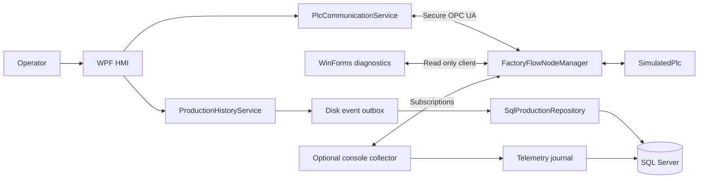
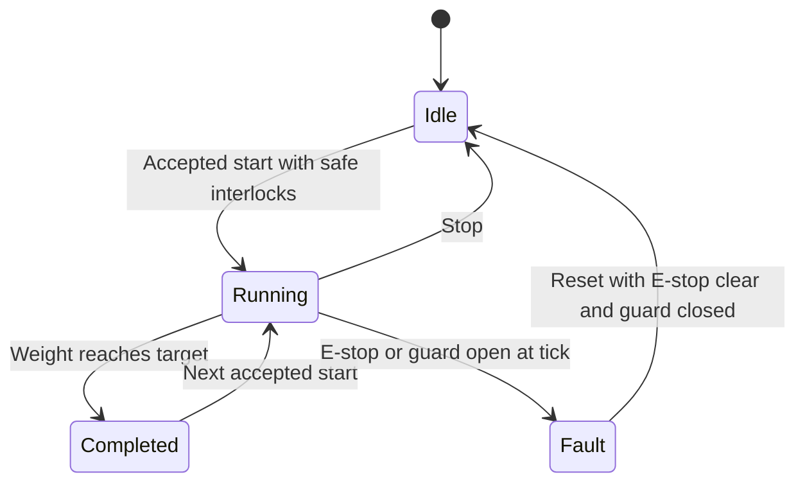

# FactoryFlow: project and interview guide

Use this guide in three passes: first understand the problem and normal job flow; then study the failure cases and code; finally practise the demonstration and questions aloud. The purpose is to explain decisions and evidence, not memorize buzzwords.

This guide describes the implementation in this workspace on October 19, 2026. FactoryFlow is a local industrial-automation simulation. The collector is an optional console application. There is no Windows Service.

## 1. The problem statement

A production operator needs to select a recipe, start or stop a weighing batch, watch its progress, and understand why the machine stopped. Supervisors need configurable recipes, and production staff need a history showing what ran, who initiated it, the target, the measured result, and the outcome.

Connecting a screen to a machine is only part of the problem. Networks disconnect, SQL becomes unavailable, messages arrive at different times, and users click commands while conditions change. A useful system must avoid displaying an assumed success, starting a job twice, recording a stale final weight, or losing events simply because a database connection failed.

**FactoryFlow's objective:** demonstrate a working path from operator action → PLC-style state machine → secure OPC UA updates → responsive desktop UI → traceable SQL production history, with explicit handling of uncertainty.

The simulated process is weighing feed. Soy Feed has a 250 kg target and Corn Feed has a 500 kg target in the existing database. The simulator adds 5 kg on each 250 ms tick until the selected target is reached. These increments are simulated measurements, not readings from a physical scale.

## 2. Your opening explanation

### A 30-second answer

> “FactoryFlow is a C# desktop automation project for recipe-based batch production. A .NET 8 simulated PLC exposes machine state and commands through a secure OPC UA server. A .NET Framework 4.8 WPF HMI subscribes to live values, supports operator and supervisor workflows, and records batch history and alarms in SQL Server. I focused on reliable state confirmation, reconnect handling, safe command behavior, and database retries without duplicate events.”

### A two-minute answer

> “The operator signs in using their Windows identity, selects an active recipe, and starts a batch. The application first records the start intention in SQL. It then calls one OPC UA method that validates the target and starts the simulator atomically. The display follows observed PLC state; a successful write is not treated as proof that production started.
>
> “The simulator checks guard and E-stop conditions and publishes state, weight, and timestamps. The client uses subscriptions, validates data quality and freshness, and recreates its session and monitored items after a disconnect. It does not replay commands after reconnect.
>
> “Production transitions go through a disk-backed outbox before being applied to SQL. Each event has a stable unique identity, so a retry after an uncertain commit does not duplicate the event. Recipe and target snapshots preserve the meaning of historical batches. Alarm acknowledgement records the operator response independently of clearing the physical cause or resetting the fault.
>
> “The project includes a WinForms diagnostics tool, an optional manually launched telemetry collector, NUnit tests, SQL/OPC integration checks, and a CI configuration. The testing is local and simulated; I would still need real hardware commissioning and a production security review before deployment.”

Use “I” only for work you can personally explain. Before an interview, walk through the code and modify a small feature yourself. If asked about development assistance, describe it honestly and explain how you reviewed and tested the result.

## 3. What is in the solution?

| Project or folder | Responsibility | Technology |
|---|---|---|
| `FactoryFlow.PlcSimulator` | State machine, OPC address space, command handlers and periodic publication | .NET 8 console, OPC Foundation Server |
| `FactoryFlow.PlcClient` | Secure client session, subscriptions, typed snapshots, reconnect and commands | .NET Framework 4.8 library |
| `FactoryFlow.HMI` | Operator dashboard, history, alarms, recipes, access management | WPF, .NET Framework 4.8 |
| `FactoryFlow.Core` | Shared models and machine-status enum | .NET Framework 4.8 library |
| `FactoryFlow.Data` | SQL access, migrations, durable event recorder and CSV export | ADO.NET/System.Data.SqlClient |
| `FactoryFlow.Diagnostics` | Independent read-only PLC connection and tag diagnostics | WinForms, .NET Framework 4.8 |
| `FactoryFlow.Collector` | Optional independent raw telemetry recording | Manually started .NET Framework 4.8 console |
| `configuration` | Example XML tag mapping | XML |
| `tests` | NUnit, SQL/OPC integration and existing smoke checks | .NET 8 and .NET Framework 4.8 |
| Root `azure-pipelines.yml` | Windows build, NUnit execution and TRX publishing | Azure Pipelines configuration |

The WPF screen is implemented with code-behind and separate communication/data services. **Do not describe it as a complete MVVM implementation.** It does not use Entity Framework, a web API, a message broker, or microservices.

The different runtimes communicate across the OPC UA network boundary. The net48 HMI does not load the net8 simulator assembly. Unit tests reference the simulator; the older-runtime integration harness communicates with a separate simulator process.

## 4. Architecture and the two main flows



**Command flow:** operator → HMI → command eligibility checks → client → OPC method/write → server validation → state machine.

**Observation flow:** simulator tick → OPC value/timestamp publication → monitored-item notification → validated immutable snapshot → WPF Dispatcher → display and production recorder → SQL.

The simulator owns machine truth. SQL owns the recorded production history. The HMI owns the operator interaction and the batch identity for jobs it starts. Those responsibilities overlap through messages; they are not one shared transaction.

## 5. Follow one job from beginning to end

1. The HMI connects to SQL, applies the additive migrations to the existing database, and loads active recipes.
2. Sign-in looks up the current Windows account in `dbo.Operators`. An enabled Operator can perform production actions; a Supervisor can also manage recipes and access.
3. The OPC client selects the required secure endpoint, establishes a session, resolves the namespace URI, creates monitored items and reads initial values.
4. Start is enabled only when the PLC snapshot permits it, SQL logging is ready, an operator is signed in, and there is no locally tracked active batch.
5. `ProductionHistoryService.BeginBatchAsync` flushes the previous job's pending terminal event. SQL creates a correlated batch in **Starting** and records the request before any start command is sent.
6. SQL checks that the recipe is still active and that its target matches the target selected in the HMI. A changed recipe requires reloading rather than silently running a different target.
7. `PlcCommunicationService.StartBatchAsync(double)` calls `Line1.StartBatchWithTarget` with the selected target.
8. The OPC server validates the argument and checks the simulator state and interlocks. Assigning the target and entering Running happen under the same operation/locks.
9. Actual observed Running changes the recorded batch to **Running**. A command response alone is not enough.
10. The simulator ticks, increases weight, clamps exactly to the target, and changes to Completed.
11. The recorder waits for coherent state/weight observations before saving the final weight. It records completion through its durable outbox.
12. Completed remains visible. The next accepted Start resets the weight to zero and begins another job. The previous completion is flushed before the next SQL start.

**Important distinction:** a batch correlation GUID groups a job's activity; each event's EventKey identifies one specific event for duplicate prevention.

## 6. Understand the state machine



| PLC state | Numeric value | Meaning |
|---|---|---|
| Idle | 0 | Ready for a new accepted start |
| Running | 1 | Simulated weighing in progress |
| Completed | 2 | Target reached; result retained |
| Fault | 3 | Interlock fault latched until safe reset |

Start accepts Idle or Completed, validates a finite target in the range 0.1–1,000,000 kg, checks interlocks, sets the target, resets weight, and enters Running. Start while Running or Fault is rejected.

Stop changes a Running PLC to Idle and retains its current weight. Reset changes a safe Fault to Idle and also retains weight. Only the next accepted Start resets weight. SQL calls an early return to Idle **Stopped**, although the PLC enum has no separate Stopped state.

Opening the guard or activating E-stop during Running is evaluated by the next simulator Tick. This is a simulated control loop with scheduling latency, not a hard real-time emergency-stop circuit. Opening a guard while Idle prevents Start; it does not itself force the Idle state to Fault.

SQL has richer lifecycle outcomes: Starting, Running, Completed, Stopped, Fault, Interrupted, Rejected and Unconfirmed. The older preserved Pending row is historical database content, not another PLC state.

## 7. OPC UA concepts you must be able to explain

**PLC:** a controller that executes machine logic. Here, `SimulatedPlc` imitates a small subset of that role in software.

**HMI:** the human-machine interface used to observe the machine and send operator commands.

**OPC UA server:** exposes an address space of typed nodes and methods. `FactoryFlowNodeManager` maps that address space to the simulator.

**OPC UA client:** discovers/connects to the endpoint, reads/writes values, calls methods and receives subscriptions. Both the HMI and UaExpert are clients.

**NodeId:** identifies a node within a namespace. In `ns=2;s=Line1.Status`, `ns=2` is the runtime namespace index, `s=` means a string identifier, and `Line1.Status` is the stable identifier string. The namespace URI is the durable identity; the numeric index can change between servers or configurations.

**Subscription and monitored item:** a subscription groups notifications; each monitored item specifies the node/attribute, sampling interval, queue and change filter. A monitored item's value can include quality and timestamps, not just a primitive number.

**Sampling versus publishing:** sampling is how often a value is evaluated for monitoring; publishing is how often notifications are sent. Both are requested at 250 ms here. These are not guarantees of end-to-end latency.

The client monitors Status, ActualWeight, EStopActive and GuardClosed. Command pulses are written when needed. TargetWeight is exposed but is not part of the four-item live cache.

| Node identifier | Type | Purpose |
|---|---|---|
| `Line1.Status` | Int32, read-only | Machine-state enum |
| `Line1.ActualWeight` | Double, read-only | Simulated kg |
| `Line1.StartRequest` | Boolean, writable | Start pulse using the current simulator target |
| `Line1.StopRequest` | Boolean, writable | Stop pulse |
| `Line1.EStopActive` | Boolean, writable | Simulation interlock input |
| `Line1.GuardClosed` | Boolean, writable | Simulation interlock input |
| `Line1.TargetWeight` | Double, read-only | Current target |
| `Line1.ResetRequest` | Boolean, writable | Safe reset pulse |
| `Line1.StartBatchWithTarget` | Method under `Line1` | Atomic target/start, with Accepted output |

The original six tag identifiers remain stable; the target/reset/method extend them. Full local examples currently use `ns=2;s=...`, but the client resolves the namespace URI dynamically.

Pulse nodes return false after handling. A Good result from the legacy StartRequest write can mean the write was handled even if the machine refused to start. Check actual state. The method additionally provides an Accepted output; the HMI still confirms the resulting state.

## 8. Reliability: what makes this more than a dashboard?

### Data quality and freshness

The cache checks Good OPC quality, expected types, permitted status values, finite nonnegative weight and timestamps. Source timestamps more than five seconds old or five seconds into the future invalidate the received value. Older out-of-order samples do not replace newer cached samples. A watchdog detects missing arrivals after five seconds and triggers reconnection.

Unknown values are nullable; they are not replaced with plausible defaults such as zero weight or a safe guard state. Invalid data disables command eligibility, including ordinary Stop through this application. **Do not claim Stop works when the PLC connection/data is invalid.** The implemented guarantee is that a SQL logging outage does not prevent a valid PLC Stop.

The server republishes timestamps even when values are unchanged. The client requests `StatusValueTimestamp` changes, so Idle still produces freshness observations. This approach depends on this server's timestamp behavior. A real PLC server that timestamps only actual value changes would need a revised heartbeat/freshness strategy.

### Coherent final weights

OPC notifications for different monitored items can arrive separately. Seeing Completed with yesterday's cached Running weight would create a wrong result. The server stamps its published values together; the cache requires matching Status and ActualWeight source timestamps before a terminal weight is recorded. That is suitable for this simulator. Actual hardware requires validating its timestamp/coherence semantics, possibly adding a batch result structure or sequence number.

### Reconnect without command replay

One supervisor recreates the session and subscriptions, with retry delays increasing from 1 to 2 to 4 to 8 seconds. Cache values become unknown after loss. Each connection has a generation identifier, so old callbacks and queued commands cannot act as if they belong to the new session.

Start/Stop are not queued for replay. If a start response is lost, retrying automatically could start a second job after the first completed. The system records uncertainty and requires fresh observation/operator action instead.

### Concurrency and the UI thread

The simulator uses a shared lock around its state/weight/interlocks. Node-manager commands and Tick acquire locks in a consistent order. The client uses a state lock for the cache/snapshots and `SemaphoreSlim` for asynchronous lifecycle/I/O coordination. `lock` is reentrant on the same thread; an async semaphore permits waiting without blocking the thread.

OPC callbacks do not directly manipulate WPF controls. The HMI schedules work with `Dispatcher.BeginInvoke`, consumes immutable snapshots, and checks revision ordering to avoid rendering an older queued snapshot over newer data. SQL calls are asynchronous. Local journal writes are synchronous and flushed to disk, so do not claim that every part of recording is nonblocking or immune to disk delays.

## 9. SQL design and durable recording

The project uses ADO.NET with parameterized commands, explicit transactions and short-lived pooled SQL connections. It uses both stored procedures and inline parameterized SQL; do not say every query is a stored procedure.

| Table | Why it exists |
|---|---|
| `Recipes` | Current configurable recipe names/targets and active flags |
| `Batches` | One recorded job's recipe/target snapshot, actor, outcome, final weight and UTC times |
| `MachineEvents` | Detailed commands, state changes, diagnostics and actor audit, with EventKey and Source |
| `ProductionLines` | Line identity and HMI-observed status |
| `Operators` | Real Windows-account mappings to enabled Operator/Supervisor roles |
| `Alarms` | Alarm instances with separate raise, clear and acknowledgement metadata |
| `AlarmSignalState` | Last observed safety-signal state/time to reject duplicate or reordered transitions |

Views provide reporting shapes; bounded stored procedures filter history and alarms. The batch-history index starts with LineId and StartedAt, matching the principal line/date query. Other indexes support line/time event queries and uniqueness. `OPTION(RECOMPILE)` is used for the optional-status history query; it trades compilation work for a plan tailored to that invocation. It is not a universal performance fix.

**Why copy recipe data into Batches?** A Supervisor can change today's recipe name/target without rewriting what a previous batch actually ran. A historical row that only joins the current recipe would otherwise change its apparent meaning.

**Why UTC?** It provides one timeline for comparisons and audit across locations. The HMI date filters are local dates converted to UTC boundaries. SQL timestamp columns are shown as UTC. These are observation times, not proof of the exact physical transition instant.

### The outbox sequence

1. Create an activity with a stable EventKey.
2. Write JSON to a temporary file, flush it, then rename it to its final ordered journal filename.
3. The worker reads pending files in order and applies each event in a SQL transaction.
4. SQL checks EventKey and uses a unique index to prevent duplicate insertion. Batch/event changes belong to the same transaction.
5. Delete the local file only after the database operation succeeds.

If SQL commits but the client loses the response, the file remains. Retrying the same EventKey does not insert a second event. This is **retryable delivery with idempotent database application**, not an atomic exactly-once transaction across PLC, disk and SQL. Disk loss, corruption, missed observations and retention still matter.

An exclusive journal-folder lock prevents two HMI recorders from consuming the same outbox. An `active.batch` marker supports interrupted-tracking recovery. SQL also serializes starts for a line with an application lock and refuses a new start when an unfinished correlated Starting/Running row exists.

### Failure outcomes you should distinguish

| Situation | Implemented behavior |
|---|---|
| SQL unavailable before Start | Start is blocked because its initial record cannot be committed |
| SQL unavailable after production starts | Events remain in the local outbox and retry; valid PLC Stop remains available |
| PLC monitoring lost during a tracked job | Recorded outcome becomes Interrupted; no invented completion or final weight |
| Start outcome cannot be confirmed | Unconfirmed/appropriate observed outcome; no automatic command replay |
| HMI closed during a tracked job | Observation is Interrupted; the HMI does not issue an implicit Stop |
| Another client starts production | UntrackedBatchRunning event; no invented recipe/batch identity |
| Acknowledgement repeated | Original acknowledgement remains; duplicate acknowledgement is harmless |
| Recipe changed after HMI loaded it | Start rejects the stale selection and asks for reload |

The outbox stores observed events; it cannot recover transitions that occurred while every observing process was stopped. The optional collector preserves raw observations only while its console process runs, and does not complete the HMI's interrupted batch ledger automatically.

## 10. Alarms, access and security

**Raised** means an alarm condition was observed. **Cleared** means its cause is no longer observed. **Acknowledged** means an operator recorded awareness. **Reset** is a separate controller command to leave the latched Fault state when interlocks are safe. These four concepts must not be conflated.

Acknowledging a guard alarm does not close the guard. Closing the guard does not itself reset the Fault. Resetting does not erase the batch's Fault outcome. The three-second alarm refresh preserves the selected AlarmId so an operator can acknowledge the row even after refresh.

Sign-in uses the already authenticated Windows identity; it does not prompt for another account or store an application password. SQL compares the actor to `ORIGINAL_LOGIN()`. Supervisors can manage recipes and real Windows-account mappings. Bootstrap is allowed only when the operator table is empty, and access changes cannot remove the final enabled Supervisor.

OPC uses Basic256Sha256 with SignAndEncrypt. Application certificates establish trusted application peers. The session user token is Anonymous: **application trust is not per-operator authorization.** A trusted external OPC application can still write the writable simulation nodes. Production would need server-side user/role controls in addition to HMI roles.

Certificate verification is enabled; there is no accept-all handler. Unknown peers must be inspected and explicitly trusted. Copy only public certificate files after identity/thumbprint verification, never private keys. Certificates/private keys are local runtime material, not source-control content.

SQL currently uses integrated authentication, encrypted transport and `TrustServerCertificate=True` for the local SQL Express development certificate. That flag skips validation of the SQL server certificate; it is separate from OPC certificate validation. Production needs a valid SQL certificate and validation enabled. The current HMI account can apply schema migrations; separating migration privileges from runtime privileges is another production step.

## 11. Configuration reference

Workspace: `E:\VisualStudioProject\Project2`. Solution directory: `FactoryFlow`.

| Setting | Current/default value | Where to change it |
|---|---|---|
| HMI runtime | .NET Framework 4.8 | HMI/Core/Data/PlcClient project files |
| Simulator/runtime tests | .NET 8 | Simulator and NUnit project files |
| Build SDK observed locally | .NET SDK 10.0.402 | Installed build tools; SDK and runtime are different concepts |
| OPC packages | OPC Foundation Server/Client/Configuration 2.0.1 | Appropriate `.csproj` PackageReference |
| OPC discovery URL | `opc.tcp://localhost:4840` | HMI App.config `PlcEndpoint`; simulator `--port` |
| Advertised local endpoint | `opc.tcp://laptop-l89ek2po:4840/` | Server/host discovery result; machine-specific |
| Namespace URI | `urn:factoryflow:plc:line1` | HMI `PlcNamespaceUri`, server constants |
| XML mapping | Empty by default; built-in identifiers used | HMI `PlcTagMapPath`; sample `configuration/TagMap.FactoryFlow.xml` |
| SQL instance/database | `localhost\SQLEXPRESS` / `FactoryFlowDB` | HMI/Collector App.config connection string |
| SQL connection override | `FACTORYFLOW_SQL_CONNECTION` | Process environment; overrides configured connection string |
| HMI endpoint override | `FACTORYFLOW_OPC_ENDPOINT` | Process environment |
| Tick / monitored sampling / publication | 250 ms each | Server Program and client subscription code |
| Client notification queue | 10 per monitored item, discard oldest | Client subscription code |
| Freshness checks | Five seconds | `PlcValueCache.cs` |
| HMI pending events | `FactoryFlow.HMI/bin/Debug/net48/production-outbox` | Path constructed beside HMI executable |
| HMI/Diagnostics/Simulator OPC PKI | `pki` beside each executable | Client/server initialization |
| Collector data root | `%LOCALAPPDATA%\FactoryFlow\Collector` | `FACTORYFLOW_COLLECTOR_ROOT` override |
| Collector sources | `1|opc.tcp://localhost:4840|urn:factoryflow:plc:line1` | Collector App.config `Sources`, or `FACTORYFLOW_COLLECTOR_SOURCES` |
| Collector weight interval | Five seconds | Collector App.config `WeightSampleSeconds` |
| Recipe target range | 0.1–1,000,000 kg | Validated by UI/data/simulator paths |

Edit source App.config and rebuild to regenerate the executable's `.exe.config`. Direct edits to generated output configuration can be overwritten by a build. Environment overrides affect only processes that inherit them; restarting an application may be necessary.

The XML map translates canonical names such as `Line1.Status` to string or numeric identifiers in the resolved namespace. It is not a complete vendor protocol adapter. Real hardware must also provide matching types, appropriate method/handshake behavior and valid timestamps. Renaming tags alone cannot make every Rockwell/Siemens controller compatible with this simulator-specific method.

The additive migrations expect the original Batches, Recipes, ProductionLines and MachineEvents tables already to exist. **This is an upgrade of the existing project/database, not a complete empty-machine database provisioning package.** Preserve that database and its backups when moving the demonstration.

## 12. Start, demonstrate, verify and close

### Before the interview

Have SQL Server Express running, the existing FactoryFlowDB available, .NET Framework 4.8 runtime/targeting tools installed, and the required .NET SDK/runtime available. Restore packages ahead of time. Use one simulator on port 4840; check an existing instance before launching another. Finish any batch and close applications that lock binaries before rebuilding.

From PowerShell:

```powershell
Set-Location E:\VisualStudioProject\Project2
dotnet restore FactoryFlow/FactoryFlow.slnx
dotnet build FactoryFlow/FactoryFlow.slnx --no-restore -m:1
dotnet run --project FactoryFlow/FactoryFlow.PlcSimulator --no-build
```

Leave that terminal open. In a second terminal:

```powershell
Set-Location E:\VisualStudioProject\Project2
.\FactoryFlow\FactoryFlow.HMI\bin\Debug\net48\FactoryFlow.HMI.exe
```

Wait for Database Connected, sign in with Windows, then Connect PLC. On a fresh trusted application identity, inspect/exchange public peer certificates first as explained in README. No Windows Service installation is part of this workflow.

### An eight-minute interview demonstration

| Step | Show | Explain |
|---|---|---|
| 1 | Connected PLC/SQL, signed-in operator | Separate machine and recording readiness |
| 2 | Select 250 kg recipe and Start | SQL intent first, atomic target/start, observed Running |
| 3 | Live weight → Completed | Subscriptions, exact target clamp; about 12.5 seconds |
| 4 | Start another job | Completed permits next start; previous history retained |
| 5 | Open simulated guard during Running | Latched fault, recorded partial weight, reset disabled |
| 6 | Close guard; Reset Fault | Safe reset returns Idle without erasing failed-job history |
| 7 | Alarms; select and acknowledge; include closed | Clear, acknowledge and reset have different meanings |
| 8 | Batch history; refresh; export CSV | UTC audit, target/name snapshots, operator, outcome |
| 9 | SSMS query of Batches/MachineEvents/Alarms | Data is actually persisted in SQL |
| 10 | Read-only Diagnostics, if time permits | Separate client validates the server independently |

Practice this once without an audience. Demonstration jobs create real rows in your local demo database. Do not delete old rows to make the screen look clean; filter history instead. Do not perform a deliberate SQL outage or restart during an interview unless you have rehearsed the recovery and can identify exactly which local process is safe to affect.

### Read-only SQL verification

Connect SSMS to `localhost\SQLEXPRESS` with Windows authentication:

```sql
USE FactoryFlowDB;

SELECT TOP (10)
    BatchId, RecipeName, Status, TargetWeight, ActualWeight,
    OperatorAccount, StartedAt, EndedAt, CorrelationId
FROM dbo.vwFactoryFlowBatchHistory
ORDER BY BatchId DESC;

SELECT TOP (30)
    EventType, EventValue, OccurredAt, OperatorAccount, Source,
    EventKey, BatchCorrelationId
FROM dbo.MachineEvents
ORDER BY EventId DESC;

SELECT TOP (10)
    AlarmCode, RaisedAt, ClearedAt, AcknowledgedAt, AcknowledgedBy, IsActive
FROM dbo.vwFactoryFlowAlarmHistory
ORDER BY AlarmId DESC;
```

For an existing BatchCorrelationId, filter MachineEvents by that GUID to reconstruct the job. `Source=HMI` identifies application activity; `Collector` identifies optional raw telemetry; `Legacy` marks pre-upgrade events. Old NULL operator fields are missing historical information, not newly fabricated users.

### UaExpert verification

Add the custom discovery URL `opc.tcp://localhost:4840`, choose Basic256Sha256/SignAndEncrypt, inspect the server certificate and establish mutual public-certificate trust. Browse Objects → Line1 and drag Status, ActualWeight and interlocks into Data Access View. Use StartRequest/StopRequest pulses or the target/start method, then verify actual state.

UaExpert-started production is external to the HMI's recipe ledger. It can produce an UntrackedBatchRunning event, so use the HMI Start button when demonstrating correlated recipe history.

### Shutdown

Finish or Stop the job, wait for SQL pending events to drain, and close the HMI. Press Ctrl+C in the simulator terminal. If you manually started the optional collector, stop it with Ctrl+C as well. Keep pending outbox files. Closing an HMI during a running job does not stop the simulator.

## 13. Test evidence and how to discuss it

The recorded local verification has **22 passed NUnit simulator cases** and **52 passed SQL/OPC integration checks**. There are additional existing client/smoke harnesses, but do not add their old totals to this verification run as if everything was executed together.

NUnit covers configurable targets, exact clamping, invalid inputs, start eligibility, consecutive jobs, stop/reset/interlocks and concurrency. Integration checks use actual assemblies, SQL Server, an owned simulator on 4843, and a separate collector console process. They cover database retries, lifecycle results, alarms, roles, reporting and independent telemetry.

The integration run creates a separate retained database such as `FactoryFlowDB_LoggingTests_20261019_051012`. It does not insert its 10,000-row fixture or 25,000-event benchmark into normal FactoryFlowDB.

Recorded measurements:

- 25,000 unique events inserted in 1.018 seconds in the local bulk-ingestion scenario; retry did not duplicate them.
- History p95 of 19.847 ms across 20 warm queries returning 1,000 rows from a 10,000-batch fixture.
- Normal WPF history screen loaded seven existing/demo rows in 9 ms during the GUI check.

Explain **p95** as the latency near which 95% of measured requests finish, rather than the average or worst case. Twenty warm local samples are a limited demonstration, not a robust production SLA. Bulk throughput is not a 24-hour endurance result. The GUI's query-plus-transfer measurement is also not identical to isolated SQL engine time.

The 74-check result predates the final removal of the Windows Service wrapper; the resulting console-only collector was subsequently rebuilt successfully. Its core collector integration tests had already exercised console mode. Do not claim the whole suite was rerun after every documentation or wrapper change.

Commands after a normal solution build:

```powershell
dotnet test FactoryFlow/tests/FactoryFlow.UnitTests --no-build --no-restore -m:1
.\FactoryFlow\tests\FactoryFlow.Data.IntegrationTests\bin\Debug\net48\FactoryFlow.Data.IntegrationTests.exe E:\VisualStudioProject\Project2\FactoryFlow
```

The integration command needs SQL create-database permissions and port 4843 available. CI configuration is supplied, but no hosted Azure pipeline execution or code-coverage percentage has been established. Build succeeds with warnings about transitive net48 support; vulnerability metadata was unavailable during restore. Test success does not remove those dependency-support/audit concerns.

## 14. Interview questions and answer outlines

### 1. Why use subscriptions instead of continuously polling the UI?

Subscriptions deliver server-monitored changes with quality/timestamps and keep communication in a reusable service. Initial reads and post-command refresh reads still exist. The one-second watchdog checks cached freshness; it is not a periodic PLC read loop. At 250 ms timestamp-triggered notifications, this implementation deliberately prioritizes fresh observations over minimal idle traffic.

### 2. How do you know Start succeeded?

The method must accept the target/start request, and the client then observes actual Running. A handled OPC write is not proof the machine accepted production. SQL stays Starting until real Running is observed.

### 3. Why use an OPC method for recipe/start?

Separate target and start writes allow another client to change the target between operations. The method validates and starts under one server operation/lock. That atomicity is within the simulator, not across SQL and OPC.

### 4. What happens if SQL committed the start but the PLC request fails?

The system already has an audit trail for the intention. It records a rejection or uncertainty based on what it can observe; it does not roll back physical machine behavior or invent success. This is a distributed consistency problem, not something a SQL transaction alone solves.

### 5. What happens if the database is unavailable?

New starts require the initial SQL commitment, so they fail closed for traceability. Later events queue on disk. Stop can proceed when PLC communication/data is valid even if SQL logging fails.

### 6. How do retries avoid duplicates?

Stable EventKeys, a uniqueness constraint, and transactional SQL application. A retry after a lost commit response reuses the same identity. Local-file deletion follows success, rather than preceding the database commit.

### 7. Is this exactly-once processing?

No end-to-end exactly-once guarantee. It is durable local retry with idempotent SQL effects for observed events. PLC actions, disk files and SQL are not a single distributed transaction. Describe the remaining crash/disk/missed-observation cases.

### 8. Why do status and weight need coherence?

They arrive through different callbacks. Completed could otherwise be combined with an earlier partial weight. Matching source timestamps works because this simulator stamps its published set together; real equipment needs its own validated consistency contract.

### 9. What prevents old data from corrupting the UI after reconnect?

Connection generations reject old-session callbacks and commands. Snapshot revisions prevent older queued UI updates from replacing newer ones. Bad or stale values are shown as unknown rather than safe defaults.

### 10. Why never replay a failed Start automatically?

A lost response leaves ambiguity: the machine may already have started. Replaying could cause an unintended later batch. Fresh observation and a deliberate next action are safer than blind retrying of a physical command.

### 11. How is thread safety achieved?

Shared simulator state uses a lock; server operations/ticks use a consistent lock order; client state has its own lock; async semaphores coordinate I/O/lifecycle; immutable snapshots cross to the Dispatcher. Discuss synchronization scope, not “async makes it thread-safe.”

### 12. Why WPF, and is this MVVM?

WPF provides a desktop UI, data grids and a Dispatcher for thread-affine controls. This implementation uses code-behind with separated services. Full ViewModels, bindings/commands and UI-testable presentation logic would be a sensible refactor, not a claim about current architecture.

### 13. Why both WPF and WinForms?

WPF is the operator application. The small independent WinForms tool provides read-only connection/tag diagnostics and demonstrates a second desktop client without duplicating production commands.

### 14. How do alarm acknowledgement and fault reset differ?

Acknowledgement records human awareness in SQL. Reset asks the controller to return to Idle and is allowed only after interlocks are safe. Neither operation deletes historical faults.

### 15. How do you authorize users?

Map the current Windows identity to enabled roles in SQL, recheck privileged mutations server-side in SQL/repository operations, and audit actors. Do not claim the HMI's role table implements authorization for every external OPC client.

### 16. Why archive a recipe instead of deleting it?

Historic batches reference recipes. IsActive removes the recipe from new production choices while preserving those relationships. Target/name snapshots protect historic meaning against later edits.

### 17. How did you improve query performance?

Bound the result size, filter by line/time, add an index aligned with those predicates/order, and measure the actual query/transfer scenario. State the local p95 result and fixture size. Inspect execution plans and production-like data before generalizing; do not say indexes make every query faster.

### 18. How would you connect a real Siemens or Rockwell PLC?

Confirm its OPC server, network/security policy, namespace, actual NodeIds and types. Commission command acknowledgement, target/start atomicity, safe reset, timestamp and restart semantics. Configure a tag map where appropriate and change the handshake contract where needed. Test on hardware with the controls team; the local simulator does not prove vendor compatibility.

### 19. Why is the collector optional?

The HMI already tracks its own jobs and writes SQL. The manually launched console collector provides independent raw samples when needed. It is not a Windows Service and has no automatic Windows startup; closing it stops that extra collection.

### 20. What would you change for production?

Prioritize server-side OPC authorization, supported/audited dependencies, validated certificates, least-privilege runtime SQL permissions, backups/retention/disk monitoring, and real hardware/failure/endurance tests. Then address multi-line ownership, stronger batch/sequence identities and presentation-layer refactoring. A physical safety system remains separate.

### 21. What is a difficult bug you can explain?

Choose one you understand in code: Completed initially blocked a subsequent Start; separate target/start writes could race; a terminal state could use an older weight; retry after commit could duplicate an event; alarm auto-refresh cleared selection. Explain the trigger, observable symptom, cause, fix and test. Do not present a bug as an event from a past employer if it occurred in this project.

### 22. What are the limitations of the current numeric model?

OPC weight and stored recorded weights use floating-point values. Exact clamping makes completion equality reliable for this controlled simulator. Real scale data needs engineering-unit precision, tolerances/calibration and an appropriate decimal/scaled-integer database model rather than assuming arbitrary sensor doubles equal the target exactly.

### Disconnects, heartbeats and background jobs

These questions distinguish a live network session, fresh process data, a running production job and a healthy recording worker. They are different signals. FactoryFlow has no dedicated `Heartbeat` OPC node and no Windows Service or external job scheduler.

### 23. What is a heartbeat, and what does it prove?

A heartbeat is a periodic sign that a particular component is still responding. Its meaning depends on who generates it and what work must occur before it changes. A network response can prove communication is alive while machine logic is stalled. A counter updated inside a PLC scan can give evidence that the scan is progressing. Neither proves the machine is safe or producing acceptable material.

In this project, explain the actual OPC keep-alive and data-freshness checks rather than claiming a dedicated heartbeat tag exists.

### 24. What heartbeat-like mechanisms does FactoryFlow actually use?

There are three relevant mechanisms:

| Mechanism | Actual configuration | What the client learns |
|---|---|---|
| Session keep-alive | `KeepAliveInterval = 1000`; bad KeepAlive status signals loss | The OPC stack reports a communication/session problem |
| Subscription keep-alive | Requested publishing interval 250 ms and KeepAliveCount 4 | Subscription liveness notifications can arrive even without a value change; actual server-revised timing can differ |
| Local freshness watchdog | Checks about every second; cached arrivals expire after five seconds | Required monitored data is no longer arriving promptly |

The server also republishes source timestamps every simulation tick. The `StatusValueTimestamp` filter lets the monitored items produce updates even when their numeric/Boolean values stay unchanged. The watchdog checks those arrivals locally; it is not an extra heartbeat read request every second.

### 25. If machine weight stays constant, does that mean communication failed?

No. Idle or Completed weight should remain constant. This simulator still updates timestamps and publishes observations. The client looks at quality, types, source time and arrival freshness rather than requiring the weight to change.

For real hardware, first establish whether unchanged tags are periodically reported. Do not use “no value change” as a universal disconnect detector.

### 26. Can the OPC session be healthy while the application data is stale?

Yes. Session health and process-data freshness are separate. A server can answer communication requests while a data source or monitoring path stops updating. FactoryFlow's watchdog looks beyond the connected flag and signals loss when required cached arrivals expire. Valid values also need acceptable source timestamps and types.

A timestamp generated by an OPC gateway could still be fresh while the underlying PLC data is old. Production commissioning must establish where timestamps come from and whether they represent actual controller progress.

### 27. Does the five-second freshness limit guarantee disconnect detection in exactly five seconds?

No. It is an application threshold, evaluated by a roughly one-second watchdog, with scheduling delays possible. OPC keep-alive or a failed operation may detect loss earlier. Reconnection then requires cleanup, retry delay, session creation and fresh data. State the configured thresholds, not a hard real-time guarantee.

### 28. What happens to a running job when the HMI loses its PLC connection?

The HMI loses trustworthy visibility; that does not prove the controller stopped. FactoryFlow invalidates its usable connection view and marks its tracked batch **Interrupted**, with no invented final weight. It does not send an implicit Stop or replay Start after reconnect.

If only the network path failed, the simulator can continue running and complete. If the simulator process itself was terminated, it stops executing and its next launch starts from initial memory. Both cases look like lost monitoring to the client until fresh observations clarify the current state.

### 29. Will reconnect resume the same SQL job automatically?

No. The recorded Interrupted outcome is preserved. After reconnection the client reads the machine's current state. If it observes Running without a locally tracked batch, it records `UntrackedBatchRunning`; it does not attach a guessed recipe or completion to the old job.

A production-grade resume protocol would need persistent controller batch identity, sequence/boot information and a reconciliation rule. A matching weight alone cannot establish that this is the same job.

### 30. What if the PLC accepted Start but the network failed before the response arrived?

That is an ambiguous command outcome. The machine may already be Running. FactoryFlow records uncertainty or the state it actually observed and does not retry the physical command automatically. The client pins an operation to its original session and rejects it if the session changes before execution.

For stronger production guarantees, consider a controller-side request ID and persisted acknowledgement/result. The controller can recognize a repeated request ID. This project does not implement a persistent machine-side command deduplication ledger.

### 31. Why use reconnect backoff? Is jitter implemented?

The client waits 1, 2, 4, then at most 8 seconds between attempts. Increasing the delay avoids continuously hammering a failed endpoint. Successful connection resets the delay.

Random jitter is not implemented. In a large deployment, jitter could reduce synchronized reconnect bursts from many clients. Describe that as a possible improvement, not existing behavior. Invalid certificates or a wrong namespace still require configuration repair; repeated attempts do not fix their cause.

### 32. How do you avoid duplicate subscriptions or callbacks after repeated reconnects?

One client supervisor owns reconnection. Cleanup detaches notification and KeepAlive handlers, closes the old session with subscriptions deleted where possible, disposes local objects, and changes the generation. New monitored items belong to the new generation. Late old-session callbacks are rejected.

If the server cannot be contacted during cleanup, immediate remote deletion cannot be guaranteed; its own session/subscription lifetime rules also matter. The local client must still stop accepting the old callbacks.

### 33. What happens if the server restarts and its namespace index changes?

The recreated session resolves `urn:factoryflow:plc:line1` again and constructs NodeIds using the current index. A hard-coded `ns=2` client could point at the wrong namespace or fail after a configuration change. Stable identifier strings are useful only together with the correct namespace identity and data contract.

### 34. How would you add a real controller heartbeat counter?

As a future extension, expose a counter updated by the controller's scan logic, subscribe to it, and record the local monotonic elapsed time since its last observed change. Define a timeout appropriate to the scan, publication rate and network. Handle counter wrap and distinguish a controller reboot with a boot/session identity where available.

Keep communication health, controller progress and production state as separate indicators. Do not let an HMI timer update the counter and then claim it proves PLC progress. The current project uses UTC timestamps for its checks; a monotonic elapsed-time watchdog would be a robustness improvement against local clock adjustments.

### 35. What background jobs run in FactoryFlow?

| Work loop | Purpose | Lifetime |
|---|---|---|
| Simulator PeriodicTimer | Tick the state machine and publish values every 250 ms | Simulator console process |
| Client supervisor/watchdog | Establish/recreate session/subscriptions and detect stale data | Client connection lifecycle |
| HMI production recorder worker | Flush durable events to SQL, approximately once per second | HMI recorder lifecycle |
| Alarm DispatcherTimer | Refresh alarms every three seconds while their tab is selected | HMI window |
| Optional collector loop | Record observed changes, sample weight and flush telemetry journal | Manually launched console process |

These are in-process tasks/timers, not durable scheduler jobs. The alarm timer updates a screen; it is not the process that owns the PLC safety logic or the SQL history recorder.

### 36. Does running a background Task make a job durable?

No. A Task ends when its process ends. Durability comes from the disk journal and SQL records, not `Task.Run` or `async/await`. The HMI has no automatic restart supervisor. The optional console collector must also be started manually.

An active marker and pending events can recover interrupted tracking when the application is reopened. They cannot recreate machine transitions that nobody observed while the applications were stopped.

### 37. What if a database flush takes longer than the worker interval?

The HMI worker awaits its flush before delaying and beginning the next iteration; it does not start a new independent flush every second regardless of previous work. An async `_flush` semaphore also serializes the worker, pre-start flushing and shutdown flushing. This prevents concurrent consumers from racing over the same outbox files.

The optional collector similarly awaits each flush. SQL command timeouts and cancellation bound operations, but a one-second interval is not a promise that every event reaches SQL within one second under load or outage.

### 38. How are background jobs cancelled on shutdown?

The client cancels its supervisor and cleans up session/subscription resources. The recorder cancels and awaits its worker, then attempts a final flush with a three-second cancellation budget. The console collector reacts to Ctrl+C and attempts a final flush with a five-second budget. Remaining journal files stay on disk for a later run.

These are intended bounded shutdown attempts, not absolute wall-clock guarantees across every OS/storage/driver operation. Force-killing a process bypasses orderly cancellation and increases reliance on the durable files already written.

### 39. How do you tell a SQL outage from an OPC disconnect?

Use independent indicators and evidence. SQL failure affects database readiness and leaves pending outbox files; OPC values can still be current. OPC failure affects session/data validity and job observation; SQL can still record Interrupted and connection events.

Investigate error type, endpoint/instance, last fresh observation, journal size and latest persisted event. A single green “connected” light for the entire system would hide these different failure modes. A dedicated end-to-end worker-health dashboard is not implemented; do not claim one exists.

### 40. What disconnect/heartbeat tests would you demonstrate or add?

Explain the expected outcome before injecting a fault:

| Scenario | Expected behavior | Scope |
|---|---|---|
| Stop/restart an owned simulator | Invalidate stale view, reconnect/recreate subscriptions, read initial state; no command replay | Existing client/integration harnesses provide related coverage; inspect their individual assertions before claiming a particular scenario passed |
| Keep session responsive but stop source updates | Freshness failure despite apparent session health | Proposed controlled fault-injection scenario; do not claim every server-stall variant is tested |
| Lose monitoring during a job | Interrupted history with unknown final result; current state re-observed afterward | Inspect lifecycle integration cases and reproduce on an isolated demo |
| Repeat reconnect cycles | No accepted old-generation callbacks or unintended commands | Verify generation and cleanup behavior; extended endurance testing remains future work |
| Lose SQL commit response | Retry same EventKey without duplicate event | Covered by idempotent retry checks in the SQL integration harness |
| Close and reopen recorder with pending files | Journal replay without invented completion | Covered by recorder recovery scenarios; preserve files for inspection |

Use a separate test simulator/database for deliberate fault injection. A hypothetical interview test plan is different from a test you actually ran and can show in logs.

### A short scenario answer to practise

> “At the time of disconnect I know my monitoring failed; I do not yet know the machine stopped. I invalidate usable values, record Interrupted for the tracked job, and reconnect with bounded backoff. I recreate subscriptions and accept only fresh values from the new session. I never automatically resend Start. SQL retries use stable event IDs because retrying an observation is different from retrying a physical action.”

## 15. Troubleshooting during preparation

| Symptom | Check first | Explain the cause |
|---|---|---|
| Address/port already in use | Existing simulator or discovery server on 4840 | Only one listener can bind the same address/port; do not stop unrelated software blindly |
| Certificate untrusted | Both application PKI stores, expected identity/thumbprint, expiry and endpoint host | Each side needs the expected peer identity; accepting every certificate hides the problem |
| Namespace/node missing | Namespace URI, XML path, identifier/type | Runtime namespace index or vendor map differs |
| Connected but unknown/commands disabled | Good quality, types, timestamps and fresh arrivals | Connection alone does not prove usable process data |
| SQL unavailable | SQL Express running, instance/database name, Windows identity, config/environment override | OPC and database connections are independent |
| Start disabled after a fault | Guard closed, E-stop clear, explicit Reset; SQL ready/sign-in | Clearing an input is different from resetting a latched fault |
| Start blocked by unfinished row | Pending outbox/active marker and unresolved recorded Starting/Running job | Review actual machine outcome; do not delete records to bypass the guard |
| Build cannot replace DLL/EXE | HMI/Diagnostics/collector running against that output folder | Close relevant applications and finish jobs before rebuilding |
| Alarm disappeared after acknowledgement | Include cleared / acknowledged checkbox | Default view hides alarms that are both cleared and acknowledged |
| History row has no actor or final weight | Legacy record or Interrupted/Unconfirmed outcome | Missing/unverified data is intentionally not fabricated |
| Collector has no records | Console is running, separate certificate trust, source endpoint, SQL access, journal/log path | It is optional and does not auto-start |

Use READMEs and actual logs to diagnose; avoid “fixes” such as turning off certificate verification, assigning fabricated final weights, deleting pending events, or replaying uncertain machine commands.

## 16. Code-reading route

Open these files in this order and trace a Start while reading:

1. `FactoryFlow.PlcSimulator/SimulatedPlc.cs`: state transitions and locking.
2. `FactoryFlow.PlcSimulator/Program.cs`: endpoint/security configuration and timer.
3. `FactoryFlow.PlcSimulator/FactoryFlowNodeManager.cs`: address space, method/write handlers, timestamps.
4. `FactoryFlow.PlcClient/Services/PlcCommunicationService.cs`: session/subscriptions, reconnect and command guards.
5. `FactoryFlow.PlcClient/Services/PlcValueCache.cs` and `PlcMachineSnapshot.cs`: quality, coherence, eligibility.
6. `FactoryFlow.HMI/MainWindow.xaml.cs`: button flow, Dispatcher and observed-state display.
7. `FactoryFlow.HMI/MainWindow.Features.cs`: sign-in, recipe/history/alarms and access workflows.
8. `FactoryFlow.Data/ProductionHistoryService.cs`: initial SQL intent, observation, outbox, recovery.
9. `FactoryFlow.Data/SqlProductionRepository.cs` and `.Features.cs`: transactions, parameters and actor checks.
10. `FactoryFlow.Data/Sql/001_ProductionHistory.sql` and `002_OperatorFeatures.sql`: schema/indexes/procedures.
11. `FactoryFlow.Data/CsvReport.cs`: CSV escaping and formula-injection protection.
12. NUnit tests and the Data integration harness: assertions that justify the behavior you claim.

All listed paths are under `E:\VisualStudioProject\Project2\FactoryFlow`. Search for `StartBatchAsync`, `BeginBatchAsync`, `OnCallMethod`, `Observe`, `FlushAsync` and `ApplyAsync` to connect the layers. Practise setting breakpoints, inspecting a snapshot, and following one batch GUID into SQL.

## 17. Preparation exercises and readiness check

**Session 1 — explain:** draw the architecture without looking, deliver the two-minute answer, explain all four PLC states and why SQL has more outcomes.

**Session 2 — trace:** step through Start and completion, identify each thread boundary, find the SQL transaction and EventKey uniqueness, explain one disconnect scenario.

**Session 3 — demonstrate:** run consecutive jobs, fault/reset/acknowledge, export history and query SQL. Practise the same sequence twice without changing configuration mid-demo.

**Session 4 — defend:** answer questions 1–40 aloud, especially the disconnect/heartbeat/background-job scenarios in questions 23–40. For each answer, name one source file and one test or observable behavior. Explain the limits before an interviewer has to discover them.

You are ready to present this project when you can:

- Explain every arrow in the architecture and locate the corresponding code.
- Distinguish request acceptance, actual Running and recorded production outcome.
- Describe what happens when SQL, OPC or the HMI fails independently.
- Explain why reconnected commands and duplicate database events need different treatment.
- Start another job after completion and recover a simulated fault without deleting history.
- Show actual SQL rows with the operator, target, result and timestamps.
- State the measured tests/performance with their exact local scope.
- Admit what is not implemented: real hardware validation, physical safety certification, automatic collector startup, complete MVVM, hosted CI proof, coverage measurement and production-grade authorization/dependency review.

This project gives you concrete material for a C# desktop/industrial integration interview. Interview readiness also requires C# fundamentals, async/await and synchronization, WPF concepts, SQL transactions/indexes, debugging, and clear explanations of your own work. No project document can guarantee the interview result; use it to practise reasoning from evidence.
