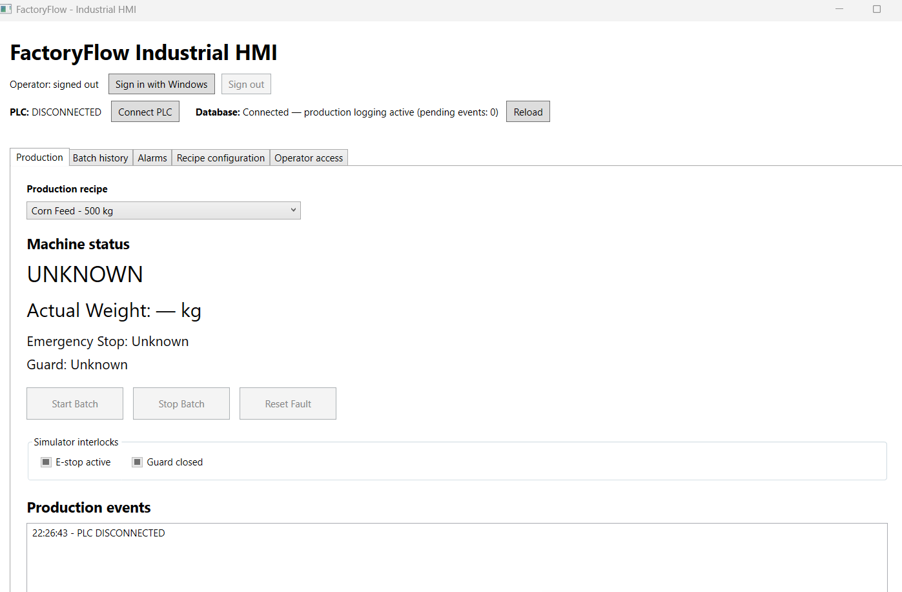

# FactoryFlow

[](LICENSE) [](https://github.com/YashZode/FactoryFlow/stargazers)

FactoryFlow is a simulated batch-production line for Windows. It includes:

- a .NET 8 **OPC UA PLC simulator**
- a .NET Framework 4.8 **WPF operator HMI**
- a **WinForms diagnostics** tool
- **SQL Server** production history
- an optional **console telemetry collector**

The HMI connects to the simulated PLC over a secure OPC UA session. Operators sign in with their Windows account, pick a recipe and run weighing batches. Batches, alarms and operator actions are recorded in SQL Server for history and reporting.



*The WPF operator HMI on the Production tab, before signing in and connecting to the PLC.*

> **Scope:** This is a simulation for development and demonstration. No physical PLC, vendor controller or safety system has been commissioned against it. The software interlocks do not replace certified safety hardware.

---

## Contents

1. [Architecture](#architecture)
2. [Prerequisites](#prerequisites)
3. [Installation](#installation)
4. [Running FactoryFlow](#running-factoryflow)
5. [Use cases](#use-cases)
6. [Configuration reference](#configuration-reference)
7. [OPC UA interface](#opc-ua-interface)
8. [Database](#database)
9. [Testing](#testing)
10. [Troubleshooting](#troubleshooting)
11. [Security notes and limitations](#security-notes-and-limitations)
12. [Further documentation](#further-documentation)
13. [Support the project](#support-the-project)
14. [License and copyright](#license-and-copyright)

---

## Architecture

```
                    OPC UA (opc.tcp://localhost:4840, Basic256Sha256 / SignAndEncrypt)
 ┌───────────────────────┐        ┌───────────────────────────┐
 │ FactoryFlow.PlcSimulator│◄──────►│ FactoryFlow.HMI (WPF)      │──┐
 │ .NET 8 OPC UA server    │        │ operator screens           │  │
 │ simulated Line1 PLC     │◄──┐    └───────────────────────────┘  │
 └───────────────────────┘   │    ┌───────────────────────────┐  │   ┌──────────────────┐
            ▲                ├───►│ FactoryFlow.Diagnostics    │  ├──►│ SQL Server        │
            │                │    │ (WinForms) tag inspector   │  │   │ FactoryFlowDB     │
            │                │    └───────────────────────────┘  │   └──────────────────┘
            │                │    ┌───────────────────────────┐  │
            │                └───►│ FactoryFlow.Collector      │──┘
     UaExpert / other        │    │ (optional console)         │
     OPC UA clients ─────────┘    └───────────────────────────┘
```

| Project | Framework | Purpose |
|---|---|---|
| `FactoryFlow.PlcSimulator` | .NET 8 | OPC UA server that simulates one line: status, weight, E-stop, guard, start/stop/reset commands. |
| `FactoryFlow.HMI` | .NET Framework 4.8 (WPF) | Operator HMI: production control, batch history, alarms, recipes, operator access. |
| `FactoryFlow.Diagnostics` | .NET Framework 4.8 (WinForms) | Standalone tool to connect to an endpoint and inspect live PLC values. |
| `FactoryFlow.Collector` | .NET Framework 4.8 (console) | Optional, manually launched telemetry collector that writes to SQL without the HMI. |
| `FactoryFlow.PlcClient` | .NET Framework 4.8 | Shared OPC UA client: secure sessions, subscriptions, reconnects, quality checks, tag maps. |
| `FactoryFlow.Data` | .NET Framework 4.8 | SQL repository, embedded schema migrations, CSV export. |
| `FactoryFlow.Core` | .NET Framework 4.8 | Domain models (`Machine`, `Recipe`, `ProductionBatch`, `Alarm`, …). |
| `tests/*` | .NET 8 / 4.8 | NUnit unit tests, an OPC UA smoke test, and SQL/OPC integration harnesses. |

OPC UA uses the OPC Foundation `UA-.NETStandard` packages, version **2.0.1**.

---

## Prerequisites

| Requirement | Notes |
|---|---|
| **Windows 10/11** | The WPF and WinForms apps need Windows. |
| **.NET 8 SDK or newer** | Builds the simulator and tests. Newer SDKs (for example .NET 10) also build the `net48` projects. |
| **.NET Framework 4.8 Developer Pack** | Needed for the HMI, Diagnostics, Collector and libraries. Visual Studio installs it with the *.NET desktop development* workload. |
| **SQL Server Express** (or another SQL Server edition) | Default instance name is `localhost\SQLEXPRESS`, using Windows integrated authentication. |
| **Visual Studio 2022 17.13+** *(optional)* | Needed to open the `.slnx` solution file in the IDE. You can also build everything from the command line. |
| **SSMS or `sqlcmd`** *(optional)* | Used to create the database and run verification queries. |
| **UaExpert** *(optional)* | A third-party OPC UA client for browsing and writing tags by hand. |

TCP port **4840** must be free for the simulator. If the Windows *UALDS* discovery service is installed, it may already be using that port. See [Troubleshooting](#troubleshooting).

---

## Installation

### 1. Get the source

```powershell
git clone https://github.com/YashZode/FactoryFlow.git
cd FactoryFlow
```

### 2. Restore and build

```powershell
dotnet restore FactoryFlow.slnx
dotnet build FactoryFlow.slnx --no-restore -m:1
```

`-m:1` builds projects one at a time. This avoids file-lock races between projects that share outputs. You may see warnings about transitive packages that do not officially support .NET Framework. They do not stop the build.

### 3. Create the database

The HMI applies FactoryFlow's migrations on startup (`001_ProductionHistory.sql`, `002_OperatorFeatures.sql`). These migrations only add to an existing schema, and they expect four base tables to exist first. On a fresh SQL Server, run this once in SSMS or `sqlcmd`, connected to `localhost\SQLEXPRESS`:

```sql
CREATE DATABASE FactoryFlowDB;
GO
USE FactoryFlowDB;
GO
CREATE TABLE dbo.Recipes(RecipeId int IDENTITY PRIMARY KEY, RecipeName nvarchar(100) NOT NULL, TargetWeight float NOT NULL);
CREATE TABLE dbo.ProductionLines(LineId int IDENTITY PRIMARY KEY, LineName nvarchar(100) NOT NULL, Status nvarchar(30) NOT NULL);
CREATE TABLE dbo.Batches(BatchId int IDENTITY PRIMARY KEY, RecipeId int NOT NULL REFERENCES dbo.Recipes(RecipeId),
    LineId int NOT NULL REFERENCES dbo.ProductionLines(LineId), Status nvarchar(30) NOT NULL,
    StartedAt datetime2 NOT NULL DEFAULT SYSUTCDATETIME(), CompletedAt datetime2 NULL);
CREATE TABLE dbo.MachineEvents(EventId bigint IDENTITY PRIMARY KEY, MachineId int NOT NULL, EventType nvarchar(100) NOT NULL,
    EventValue nvarchar(200) NULL, OccurredAt datetime2 NOT NULL DEFAULT SYSUTCDATETIME());

INSERT dbo.Recipes(RecipeName, TargetWeight) VALUES (N'Corn Feed', 500), (N'Soy Feed', 250);
INSERT dbo.ProductionLines(LineName, Status) VALUES (N'Line 1', N'Idle');
GO
```

Or, from PowerShell, save that script as `bootstrap.sql` and run:

```powershell
sqlcmd -S "localhost\SQLEXPRESS" -E -C -i bootstrap.sql
```

Leave out the `CREATE DATABASE` step and the inserts if `FactoryFlowDB` already exists with these tables. The migrations keep existing rows, and you can run them again safely.

If your SQL Server is not `localhost\SQLEXPRESS`, change the `FactoryFlowDB` connection string first. See [Configuration reference](#configuration-reference).

### 4. First run: certificates

Every application creates its own self-signed OPC UA application certificate on first start. Certificate validation stays **on**: no application accepts an unknown peer automatically. Each pair of applications must trust each other once:

1. Start the simulator. Then start the client (HMI, Diagnostics or Collector) and try to connect. The first attempt is rejected.
2. Each application's `pki` folder sits next to its executable (for example `FactoryFlow.PlcSimulator/bin/Debug/net8.0/pki`). The rejected peer certificate appears in `pki/rejected/certs`.
3. Check the certificate's application identity and thumbprint. Then move or copy **only the public `.der` file** into the other application's `pki/trusted/certs`. Do it in both directions (client ↔ server). Each application's own public certificate is in its `pki/own/certs`.
4. Restart the idle simulator and connect again.

Never copy private keys between applications. The `pki/` folders are git-ignored.

---

## Running FactoryFlow

### Option A: Visual Studio

1. Open `FactoryFlow.slnx`.
2. Select the **New Profile** multi-startup profile. It starts `FactoryFlow.HMI` and `FactoryFlow.PlcSimulator` together. To set this up by hand instead, set only those two projects to **Start**.
3. Press **F5**. Wait until the simulator console shows its endpoint. Then sign in to the HMI and click **Connect PLC**.
4. To stop: finish or stop the batch, close the HMI, then press **Shift+F5**. Check that the simulator console also closed.

### Option B: Terminals

Terminal 1, the simulator (leave it running):

```powershell
dotnet run --project FactoryFlow.PlcSimulator --no-build
# alternate port: dotnet run --project FactoryFlow.PlcSimulator --no-build -- --port 4841
```

Terminal 2, the HMI:

```powershell
.\FactoryFlow.HMI\bin\Debug\net48\FactoryFlow.HMI.exe
```

Optional tools:

```powershell
.\FactoryFlow.Diagnostics\bin\Debug\net48\FactoryFlow.Diagnostics.exe
.\FactoryFlow.Collector\bin\Debug\net48\FactoryFlow.Collector.exe
```

### Shutting down cleanly

1. Finish or **Stop** the running batch. Wait for the HMI to show the database as ready, then close the HMI window.
2. Press **Ctrl+C** in the simulator terminal for an orderly OPC UA shutdown. Restarting the simulator resets its simulated memory.
3. If the collector is running, press **Ctrl+C** in its terminal so it writes out its pending telemetry.

Do not delete files in `FactoryFlow.HMI/bin/Debug/net48/production-outbox`. They hold events that have not been written to SQL yet.

---

## Use cases

### 1. Run a production batch

1. Start the simulator and the HMI. Wait for **Database Connected**.
2. Click **Sign in with Windows**, then **Connect PLC**.
3. Pick an active recipe, for example *Soy Feed (250 kg)* or *Corn Feed (500 kg)*, and click **Start Batch**. The target weight goes to the PLC in the same call as the start command, so the two cannot get out of step.
4. Watch the weight rise by 5 kg every 250 ms. A 250 kg batch takes about 12.5 s; a 500 kg batch takes about 25 s. The status changes to **Completed**.
5. Click **Start Batch** again to run the next job.

The batch row stores a copy of the recipe name, target weight, operator Windows account, start and end times (UTC), outcome and final weight.

### 2. Stop a batch early

Click **Stop Batch** while the batch is running. The PLC goes back to Idle and keeps the weight reached so far. **Stop** still works during a SQL outage. In that case the events wait in the on-disk outbox and are written to SQL once the database is back.

### 3. Fault, alarm and safe reset

1. While a batch is running, **open the simulated guard** or **activate the E-stop**. The batch faults within one 250 ms tick, and an alarm is raised.
2. Open the **Alarms** screen. Select the alarm row and **Acknowledge** it. The acknowledgement records the operator and time. It does *not* clear the cause or reset the PLC.
3. Close the guard and clear the E-stop, then click **Reset Fault**. The PLC rejects the reset while any interlock is still unsafe.
4. The PLC returns to Idle, and a new batch can be started.

### 4. Review batch history and export a report

Open **Batch history**. Filter by local date range and status. Timestamps are shown in UTC. Click export to save the rows on screen as **CSV**.

### 5. Manage recipes (Supervisor)

Open **Recipe configuration**. Supervisors can add, edit and archive recipes, with a target between 0.1 and 1,000,000 kg. Batches that already ran keep their original recipe name and target.

### 6. Manage operator access (Supervisor)

On first run, when no operator mappings exist, setup registers the signed-in Windows account as the first **Supervisor**. The Supervisor then grants roles to other Windows accounts in **Operator access**. FactoryFlow stores no passwords. Roles control which HMI actions and SQL changes each user can make.

### 7. Inspect the PLC independently (Diagnostics)

Launch `FactoryFlow.Diagnostics.exe`, enter the endpoint (default `opc.tcp://localhost:4840`) and connect. It shows the same live values as the HMI over its own secure session. This is useful to check the PLC state while the HMI is closed. Diagnostics has its own `pki` folder, so it needs a one-time certificate exchange as well.

### 8. Collect telemetry without the HMI (Collector)

The HMI already logs the jobs it runs. Use the collector only if you also want raw telemetry recorded while the HMI is closed.

```powershell
# one-time: create the collector's certificate, then exchange public certs with the simulator
.\FactoryFlow.Collector\bin\Debug\net48\FactoryFlow.Collector.exe --prepare-certificates

# run until Ctrl+C
.\FactoryFlow.Collector\bin\Debug\net48\FactoryFlow.Collector.exe

# run for 30 seconds, then stop
.\FactoryFlow.Collector\bin\Debug\net48\FactoryFlow.Collector.exe --console --duration 30
```

The collector records weight samples (every 5 s by default) and every observed change in status, interlocks and connection. It reconnects on its own after a simulator restart. Its data lives under `%LOCALAPPDATA%\FactoryFlow\Collector`: `collector.log`, `pki/line1` and the durable `telemetry-outbox`. Run at most one collector per data root. Run the HMI once before the first collector run so the SQL migrations are applied.

### 9. Drive the PLC from a third-party OPC UA client (UaExpert)

1. In UaExpert, add a server with the custom discovery URL `opc.tcp://localhost:4840`.
2. Choose **Basic256Sha256 / SignAndEncrypt** with **Anonymous** identity. Inspect and trust the FactoryFlow server certificate.
3. The first connection is rejected. Trust UaExpert's public certificate on the simulator side (see [certificates](#4-first-run-certificates)), restart the idle simulator, and reconnect.
4. Browse **Objects → Line1** and drag the tags into the Data Access View. Write `StartRequest = true` to start a batch, `StopRequest = true` to stop it, or toggle `GuardClosed` / `EStopActive` to test the interlocks.

---

## Configuration reference

### HMI: `FactoryFlow.HMI/App.config`

Built output: `FactoryFlow.HMI.exe.config`.

| Key | Default | Meaning |
|---|---|---|
| `PlcEndpoint` | `opc.tcp://localhost:4840` | OPC UA server endpoint |
| `PlcNamespaceUri` | `urn:factoryflow:plc:line1` | Namespace URI. The client looks up its index at runtime. |
| `PlcTagMapPath` | *(empty)* | Optional XML tag map (see `configuration/TagMap.FactoryFlow.xml`) |
| Connection string `FactoryFlowDB` | `Server=localhost\SQLEXPRESS;Database=FactoryFlowDB;Integrated Security=True;Encrypt=True;TrustServerCertificate=True;…` | SQL Server connection |

### Collector: `FactoryFlow.Collector/App.config`

Built output: `FactoryFlow.Collector.exe.config`.

| Key | Default | Meaning |
|---|---|---|
| `Sources` | `1\|opc.tcp://localhost:4840\|urn:factoryflow:plc:line1` | One or more `lineId\|endpoint\|namespaceUri` entries, separated by `;`. Each `lineId` must exist in `dbo.ProductionLines`. |
| `WeightSampleSeconds` | `5` | Interval between weight samples |
| `TagMapPath` | *(empty)* | Optional XML tag map |
| Connection string `FactoryFlowDB` | as above | SQL Server connection |

Environment overrides for the collector, useful for isolated test setups:

| Variable | Overrides |
|---|---|
| `FACTORYFLOW_COLLECTOR_ROOT` | Data root (default `%LOCALAPPDATA%\FactoryFlow\Collector`) |
| `FACTORYFLOW_COLLECTOR_SOURCES` | `Sources` |
| `FACTORYFLOW_SQL_CONNECTION` | SQL connection string |

### Simulator

| Option | Meaning |
|---|---|
| `--port <n>` | Listen on a port other than 4840 |
| `FACTORYFLOW_VERBOSE=1` | Turn on OPC UA SDK diagnostic logging |

### Tag map: `configuration/TagMap.FactoryFlow.xml`

This file maps the names FactoryFlow uses internally (for example `Line1.Status`) to OPC UA node identifiers. To connect to a real controller, change the identifiers to match that controller's namespace and data types. Then check each tag against the real device before relying on it.

---

## OPC UA interface

- **Endpoint:** `opc.tcp://localhost:4840`
- **Security:** Basic256Sha256 / SignAndEncrypt, Anonymous identity. The server has no unsecured endpoint.
- **Namespace URI:** `urn:factoryflow:plc:line1`. Look up the index from the server's NamespaceArray rather than hard-coding `ns=2`.

| Node (within namespace) | Type | Access |
|---|---|---|
| `s=Line1.Status` | Int32: 0 Idle, 1 Running, 2 Completed, 3 Fault | Read |
| `s=Line1.ActualWeight` | Double (kg) | Read |
| `s=Line1.TargetWeight` | Double (kg) | Read |
| `s=Line1.StartRequest` | Boolean pulse | Write `true` to start with the current target |
| `s=Line1.StopRequest` | Boolean pulse | Write `true` to stop |
| `s=Line1.ResetRequest` | Boolean pulse | Write `true` to reset a fault (only accepted when safe) |
| `s=Line1.EStopActive` | Boolean | Read/write (simulation only) |
| `s=Line1.GuardClosed` | Boolean | Read/write (simulation only) |
| `s=Line1.StartBatchWithTarget` | Method on `s=Line1` | In: `Double TargetWeightKg`; Out: `Boolean Accepted` |

Pulse nodes return to `false` once processed. Read `Status` to confirm what actually happened. Writes to read-only nodes fail with `BadNotWritable`, and writes with the wrong type fail with `BadTypeMismatch`.

---

## Database

| Object | Contents |
|---|---|
| `dbo.Batches` | Recipe and target snapshot, operator, line, correlation ID, outcome, UTC timestamps, final weight |
| `dbo.MachineEvents` | Commands, state changes, operator actions, interlocks, connection/quality diagnostics, weight samples. `Source` marks the writer: HMI, Collector or Legacy. |
| `dbo.Recipes` | Recipe name, target weight, active flag |
| `dbo.Operators` | Windows account ↔ display name, role, enabled flag |
| `dbo.Alarms` | Raised, cleared and acknowledged times; who acknowledged; optional batch link |
| `dbo.AlarmSignalState` | Last-seen safety-signal marker. Stops duplicate or out-of-order alarm transitions. |
| `dbo.ProductionLines` | Line identity and its last connection/state as seen by the HMI |
| `dbo.vwFactoryFlowBatchHistory`, `dbo.vwFactoryFlowAlarmHistory` | Reporting views behind the history screens |

To check the stored data, run `FactoryFlow.Data/Sql/VerifyProductionHistory.sql` in SSMS. Rows created before the migrations may have NULL operator or target values, because that data was never recorded. See [DATABASE-LOGGING.md](DATABASE-LOGGING.md) for details.

---

## Testing

```powershell
# NUnit tests for the simulated PLC state machine
dotnet test tests/FactoryFlow.UnitTests

# OPC UA smoke test (.NET 8). Prepare its certificate, exchange public certs with the simulator, restart the simulator, then run:
dotnet run --project tests/FactoryFlow.OpcUaSmokeTest -- --prepare
dotnet run --project tests/FactoryFlow.OpcUaSmokeTest

# SQL + OPC integration harness (argument = repository root)
.\tests\FactoryFlow.Data.IntegrationTests\bin\Debug\net48\FactoryFlow.Data.IntegrationTests.exe (Resolve-Path .)
```

- The smoke test leaves the PLC in **Fault** on purpose. Restart the simulator before running it again.
- The integration harness needs permission to create databases. It creates its own `FactoryFlowDB_LoggingTests_*` database and keeps it afterwards. It starts a separate simulator on port **4843** and never touches your normal `FactoryFlowDB`.

---

## Troubleshooting

| Symptom | Cause / fix |
|---|---|
| Simulator fails to start: port 4840 is in use | Another simulator is running, or the Windows *UALDS* discovery service is using the port. Stop it from an elevated PowerShell with `Stop-Service UALDS` (and `Start-Service UALDS` afterwards), or start the simulator with `--port 4841` and update `PlcEndpoint` to match. |
| HMI never shows "Database Connected" | Check that SQL Server Express is running and that the connection string matches your instance. Make sure the base tables exist ([step 3](#3-create-the-database)). Error 51001 means they are missing. |
| Connect PLC fails or the certificate is rejected | Complete the one-time certificate exchange in both directions, then restart the idle simulator. |
| Build errors `MSB3021` / `MSB3026` / `MSB3027` naming FactoryFlow DLLs or EXEs | A running HMI, Diagnostics, Collector or simulator is locking the output files. Close them all and build again. Do not choose "run the last successful build". |
| Reset Fault is rejected | An interlock is still unsafe. Close the guard and clear the E-stop first. |
| History shows a batch as *Interrupted* | The HMI was closed while it was tracking a running batch. Closing the HMI does not stop the PLC. |

---

## Security notes and limitations

- SQL uses encrypted transport. For local development it sets `TrustServerCertificate=True`. A production deployment needs a valid server certificate with `TrustServerCertificate=False`, plus database identities with only the permissions they need.
- OPC UA certificate validation is always on. However, the demo server allows writes from *any trusted* Anonymous application. A production deployment needs server-side user and role checks.
- HMI roles are based on Windows accounts. FactoryFlow stores no passwords.
- Not yet verified: real Rockwell/Siemens tag mapping, endurance testing with several physical lines, and a dependency vulnerability audit (NuGet vulnerability data was unavailable during the last restore).
- This is **not** a certified safety controller.

---

## Further documentation

| Document | Contents |
|---|---|
| [FactoryFlow.PlcSimulator/README.md](FactoryFlow.PlcSimulator/README.md) | Simulator state machine, threading and certificate details |
| [DATABASE-LOGGING.md](DATABASE-LOGGING.md) | Schema, migrations and logging design |
| [CLIENT-SUBSCRIPTIONS.md](CLIENT-SUBSCRIPTIONS.md) | OPC UA client subscriptions, reconnects and data quality |
| [INTERVIEW-GUIDE.md](INTERVIEW-GUIDE.md) | Problem statement, architecture walkthrough and demo script |
| [RESUME-READINESS.md](RESUME-READINESS.md) | Recorded verification results and their limits |

---

## Support the project

FactoryFlow is free to use. Clone it, learn from it, adapt it for your own simulations or demos, and build on it.

If you find it useful, please **⭐ star the repository** on [GitHub](https://github.com/YashZode/FactoryFlow). Stars help other people discover the project and keep development going. Issues and pull requests are welcome too.

---

## License and copyright

Copyright © 2026 Yash Ananta Zode.

FactoryFlow is released under the [MIT License](LICENSE). You may use, copy, modify and distribute it, including for commercial purposes, as long as you keep the copyright and license notice. The software is provided "as is", without warranty of any kind.
